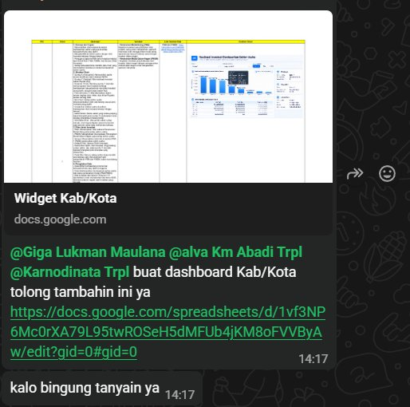
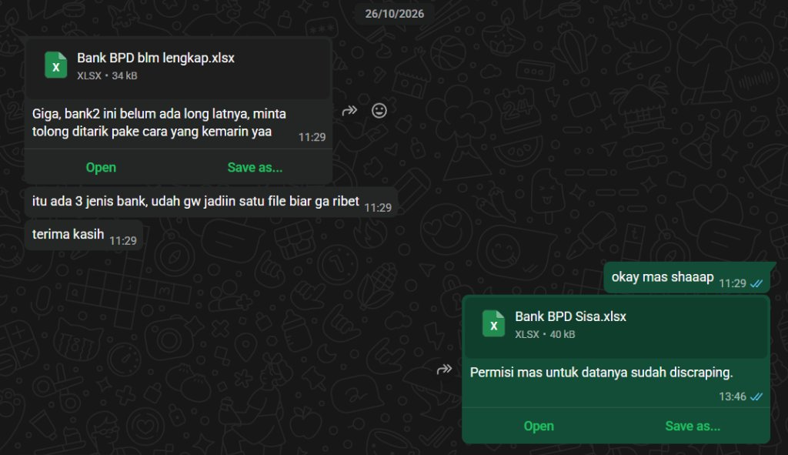
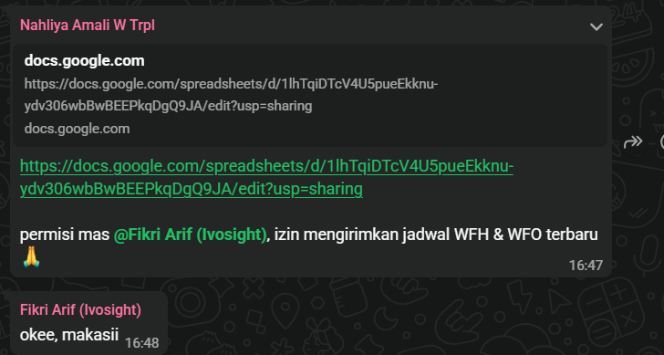

# Analisis Komunikasi Teknis dan Bisnis Berbasis Kasus Nyata di Lingkungan PKL

Dokumen ini disusun untuk menyelesaikan penugasan mata kuliah Komunikasi Teknis dan Bisnis dengan **mengangkat 100% fakta dan data percakapan nyata (*real chat evidence*)** yang terjadi selama pelaksanaan Praktik Kerja Lapangan (PKL) di industri pengembangan perangkat lunak:

1. **Kasus 1 & 2:** Instruksi penambahan widget dashboard dari lembar kerja *spreadsheet* (kejadian 23 Oktober 2026).
2. **Kasus 3:** Permintaan penarikan data (*data scraping*) koordinat geolokasi Bank BPD melalui *private chat* (kejadian 26 Oktober 2026).
3. **Kasus 4:** Pelaporan rutin berkala jadwal kerja *Work From Office* (WFO) & *Work From Home* (WFH) tim mahasiswa PKL kepada pembimbing lapangan (Mas Fikri Arif - Ivosights).

---

## PERTANYAAN 1: Perencanaan Pesan Bisnis (Klarifikasi & Pembagian Tugas Penambahan Widget)

### a. Situasi (Latar Belakang Riil)
Pada tanggal **23 Oktober 2026 pukul 14:17 WIB**, pihak koordinator proyek mengirimkan sebuah tautan *Google Sheets* berjudul *"Widget Kab/Kota"* ke dalam grup kerja dengan pesan:
> *@Giga Lukman Maulana @alva Km Abadi Trpl @Karnodinata Trpl buat dashboard Kab/Kota tolong tambahin ini ya [tautan spreadsheet] kalo bingung tanyain ya*

Di dalam *spreadsheet* tersebut, terdapat daftar tabel kebutuhan, nama indikator, dan tangkapan layar sketsa antarmuka kasar untuk grafik realisasi investasi, kuadran, dan layanan publik. Karena instruksi tersebut me-mention 3 orang mahasiswa pengembang sekaligus tanpa pembagian modul yang jelas, timbul kebingungan mengenai siapa mengerjakan apa dan modul mana yang harus diprioritaskan. Sebagai pengembang, saya perlu menyusun pesan bisnis klarifikasi dan koordinasi kepada *Tech Lead* / koordinator proyek sebelum pengodean dimulai.

### b. Tujuan Pesan
* **Tujuan Primer (Koordinasi & Klarifikasi):** Meminta kejelasan mengenai pembagian tugas (*task distribution*) antar-anggota tim (@Giga, @alva, @Karnodinata) dan urutan prioritas pengerjaan widget (*sprint prioritization*).
* **Tujuan Sekunder (Informasi):** Mengonfirmasi estimasi kapasitas kerja mingguan tim dan kesiapan data lokal pendukung untuk widget yang tertera di spreadsheet.

### c. Audiens
* **Penerima Pesan:** Koordinator Proyek / *Tech Lead* di tempat PKL.
* **Tingkat Pengetahuan:** Memahami arsitektur produk dan manajemen proyek perangkat lunak (*expert*).
* **Hubungan Kerja:** Hubungan profesional formal antara mentor industri/atasan dengan mahasiswa PKL. Pesan harus disampaikan secara santun, terstruktur, menghargai waktu penerima, dan bernada solutif (bukan sekadar mengeluh).

### d. Informasi yang Relevan & Perlu Disampaikan
1. **Rujukan Tugas:** Mengutip pesan bertanggal 23 Oktober 2026 dan tautan spreadsheet *"Widget Kab/Kota"*.
2. **Identifikasi Kebutuhan:** Menyebutkan bahwa spreadsheet memuat beberapa jenis visualisasi yang berbeda (tabel realisasi investasi, grafik kuadran, dan rasio layanan dasar).
3. **Usulan Pembagian Tugas Mandiri (*Proactive Proposal*):** Mengajukan draf inisiatif pembagian tugas agar atasan cukup menyetujui (misal: Giga memegang modul kuadran investasi & visualisasi, rekan Alva memegang tabel data, dan rekan Karno memegang penyesuaian filter wilayah).
4. **Permintaan Jadwal Penyelarasan (*Sync Meeting*):** Mengusulkan sesi sinkronisasi singkat 10–15 menit jika ada logika bisnis yang belum jelas.

### e. Media Komunikasi yang Digunakan
* **Media:** Pesan terstruktur pada kanal proyek aplikasi pesan instan kerja (Slack / WhatsApp Group Proyek).
* **Alasan:** Media ini merupakan kanal komunikasi utama tim kerja harian di tempat PKL. Pesan terstruktur berbasis teks di grup proyek menjamin transparansi, sehingga seluruh anggota tim yang di-tag mendapatkan informasi penugasan yang sama dan tidak terjadi tumpang-tindih pengerjaan kode (*code collision*).

### f. Tindakan yang Diharapkan
Koordinator proyek memberikan konfirmasi resmi:
1. Menyetujui usulan pembagian porsi widget per orang.
2. Menetapkan tanggal batas penyerahan tahap pertama (*first milestone review*).

---

## PERTANYAAN 2: Analisis Pesan Kurang Terorganisasi & Rekonstruksi Komunikasi

### a. Identifikasi 4 Kelemahan Pesan Instruksi Singkat
Mengacu pada ilustrasi soal (*"Pak/Bu, itu tugas yang kemarin ada yang kurang. Tolong diperbaiki ya, soalnya mau dipakai"*):

1. **Ketiadaan Kejelasan Objek Tugas (*Lack of Subject Clarity*):** Frasa *"tugas yang kemarin"* tidak menyebutkan nama proyek, nama modul, atau fitur spesifik yang dimaksud.
2. **Ketiadaan Rincian Cacat / Kekurangan (*Missing Problem Specification*):** Kata *"ada yang kurang"* tidak memberikan indikasi teknis apakah kekurangannya berupa data tidak cocok, tata letak visual terpotong, atau fungsi tombol tidak merespons.
3. **Ketiadaan Struktur Informasi (*Poor Structure*):** Tidak memuat konteks kejadian (5W+1H), tidak merujuk berkas pedoman acuan, dan tidak ada struktur salam maupun batas waktu penyerahan yang terukur.
4. **Nada Komunikasi Menuntut & Membingungkan (*Demanding Tone*):** Kalimat *"Tolong diperbaiki ya, soalnya mau dipakai"* menimbulkan kepanikan sepihak tanpa memberikan arahan yang dapat dieksekusi (*not actionable*).

---

### b. Contoh Nyata Pesan Kurang Efektif yang Diterima di Tempat PKL (Bukti Gambar 1 - 23/10/2026)



Pesan riil yang diterima tim pada tanggal 23 Oktober 2026 pukul 14:17 WIB:
> *"@Giga Lukman Maulana @alva Km Abadi Trpl @Karnodinata Trpl buat dashboard Kab/Kota tolong tambahin ini ya https://docs.google.com/spreadsheets/d/1vf3NP6Mc0rXA79L95twROSeH5dMFUb4jKM8oFVVByAw/edit?gid=0#gid=0"*
> *"kalo bingung tanyain ya"*

**Kelemahan Nyata Pesan Tersebut di Lapangan:**
* Di dalam tautan *spreadsheet* tersebut terdapat puluhan baris indikator dan beberapa jenis widget yang berbeda, tetapi pesan tidak menyebutkan widget nomor berapa yang harus didahulukan.
* Tiga orang mahasiswa di-tag sekaligus dalam satu kalimat tanpa ada pembagian kepemilikan tugas (*task ownership*), sehingga masing-masing anggota bingung siapa yang menjadi penanggung jawab utama.
* Kalimat penutup *"kalo bingung tanyain ya"* mencerminkan instruksi yang belum matang dan memindahkan beban analisis ruang lingkup kepada mahasiswa magang.

---

### c. Rekonstruksi (Revisi) Pesan Menggunakan Struktur: Pembukaan > Isi > Penutup

```text
[PEMBUKAAN]
Selamat siang rekan-rekan tim pengembang (@Giga Lukman Maulana, @alva Km Abadi Trpl, @Karnodinata Trpl).
Terima kasih atas progres penyelesaian fitur filter peta sebelumnya.

[ISI]
Terkait kebutuhan pembaruan pada Dashboard Kabupaten/Kota, pihak klien telah menyerahkan lembar spesifikasi kebutuhan widget tambahan melalui spreadsheet berikut:
🔗 Tautan: [https://docs.google.com/spreadsheets/d/1vf3NP6.../edit]

Agar pengerjaan berjalan efektif dan tidak tumpang-tindih pada repositori kode, berikut rincian pembagian modul dan prioritas kerjanya:
1. Giga: Fokus pada modul visualisasi grafik (Widget 01: Tren Realisasi Investasi & Widget 02: Peta Kuadran Investasi PMA/PMDN).
2. Alva: Fokus pada tabel rekapitulasi data dan penyesuaian kolom indikator kinerja di bawah grafik.
3. Karno: Fokus pada sinkronisasi pemetaan data wilayah kabupaten/kota dan penanganan filter provinsi.

Target Waktu (Deadline):
- Draf integrasi antarmuka pada server uji coba (staging): Rabu, 28 Oktober 2026, pukul 16.00 WIB.
- Sesi evaluasi internal: Kamis, 29 Oktober 2026, pukul 10.00 WIB sebelum dipresentasikan ke klien.

[PENUTUP]
Silakan tinjau lembar kerja masing-masing pada spreadsheet terlampir. Apabila ada kendala pada ketersediaan variabel data di database, silakan diskusikan di thread ini agar dapat kita koordinasikan bersama. 
Selamat bekerja dan terima kasih atas kerja sama rekan-rekan.
```

### d. Alasan Perubahan Berdasarkan Prinsip Komunikasi
1. **Kejelasan (*Clarity*) & Efektivitas:** Menguraikan peran spesifik masing-masing orang sehingga tidak ada keraguan tentang kepemilikan tugas (*clear task ownership*).
2. **Kelengkapan Informasi (*Completeness - 5W+1H*):** Menjelaskan *Apa* (penambahan widget investasi), *Siapa* (pembagian peran Giga, Alva, Karno), *Di mana* (tautan spreadsheet dan cabang branch staging), dan *Kapan* (tenggat waktu 28 Oktober pukul 16.00 WIB).
3. **Nada Komunikasi (*Professional Tone*):** Mengubah nada instruksi santai menjadi arahan kerja manajerial yang terstruktur, memotivasi, dan suportif.

---

## PERTANYAAN 3: Penyusunan *Direct Request* Terstruktur

### a. Situasi Nyata yang Membutuhkan *Direct Request* (Bukti Gambar 2 - 26/10/2026)



Pada tanggal **26 Oktober 2026 pukul 11:29 WIB**, seorang rekan/atasan mengirimkan berkas Excel bernama `Bank BPD blm lengkap.xlsx` melalui *private chat* dengan pesan:
> *"Giga, bank2 ini belum ada long latnya, minta tolong ditarik pake cara yang kemarin yaa. itu ada 3 jenis bank, udah gw jadiin satu file biar ga ribet. terima kasih"*

Tugas tersebut berhasil diselesaikan dan dikirimkan kembali pada pukul 13:46 WIB (`Bank BPD Sisa.xlsx`) dengan pesan:
> *"okay mas shaaap ... Permisi mas untuk datanya sudah discraping."*

**Situasi Direct Request Lanjutan:**
Setelah koordinat *longitude & latitude* selesai ditarik (*scraping*), untuk dapat menampilkan titik-titik kantor cabang bank tersebut ke dalam peta interaktif portal wilayah, pengembang membutuhkan data pendukung tambahan berupa **kode wilayah resmi BPS (*id_kabkota*)** dan **status operasional kantor (Pusat / Cabang / Kas)** agar ikon pada peta tidak salah kluster. Mahasiswa perlu menyusun *direct request* kembali kepada rekan penyedia data.

---

### b. Susunan Pesan *Direct Request*

```text
[PEMBUKA]
Selamat siang Mas [Nama Rekan/Atasan],
Melanjutkan hasil penarikan koordinat (scraping) Bank BPD pada berkas `Bank BPD Sisa.xlsx` yang telah saya serahkan tadi siang;

[PERMINTAAN UTAMA]
Saya ingin meminta kelengkapan data kolom atribut klasifikasi kantor bank dan kode wilayah resmi untuk seluruh titik bank tersebut.

[DETAIL PENDUKUNG]
Agar titik-titik bank BPD tersebut dapat diintegrasikan dan dipetakan secara akurat pada visualisasi peta sebaran wilayah, kami membutuhkan 2 atribut tambahan pada tabel:
1. Kolom `status_kantor`: Kategori kantor (contoh: Kantor Pusat, Kantor Cabang Pembantu, atau Kantor Kas).
2. Kolom `kode_bps`: Kode 4 digit kabupaten/kota sesuai standar BPS (contoh: 3204 untuk Kab. Bandung), guna memastikan titik bank terasosiasi ke poligon daerah yang benar saat pengguna melakukan filter wilayah.

[BATAS WAKTU]
Mengingat modul peta perbankan dijadwalkan masuk ke tahap pengujian antarmuka besok sore, kami mengharapkan berkas data atribut tambahan ini dapat kami terima paling lambat besok (Selasa, 27 Oktober 2026) pukul 11.00 WIB.

[PENUTUP]
File yang telah dilengkapi dapat dikirimkan langsung melalui pesan ini atau diunggah ke folder shared drive tim. Jika Mas membutuhkan daftar nama bank yang belum memiliki status klasifikasi, saya siap mengirimkan rekapan barisnya.

Terima kasih banyak atas bantuan dan koordinasinya, Mas.
```

### c. Pemenuhan Prinsip Komunikasi (5S)
* **Jelas (*Clear*):** Maksud permintaan dinyatakan tegas sejak awal (meminta kelengkapan atribut kantor dan kode wilayah BPS).
* **Spesifik (*Specific*):** Menyebutkan secara rinci nama kolom yang diminta (`status_kantor` dan `kode_bps`) beserta contoh nilainya.
* **Sopan (*Polite*):** Menggunakan salam formal, menghargai bantuan yang telah diberikan sebelumnya, dan menyampaikan terima kasih.
* **Ringkas (*Concise*):** Langsung berfokus pada kebutuhan teknis pemetaan tanpa narasi yang tidak relevan.
* **Terukur (*Measurable*):** Memiliki tenggat waktu penyerahan yang pasti (Selasa, 27 Oktober 2026, pukul 11.00 WIB).

### d. Keunggulan Dibanding Pesan Singkat Tidak Terstruktur
Jika pesan hanya ditulis singkat seperti: *"Mas, data banknya masih kurang nih, tolong lengkapi ya butuh cepat"*:
* Penerima akan bingung atribut apa yang kurang, format apa yang diinginkan, dan mengapa data tersebut mendesak. Hal ini akan memicu rentetan tanya-jawab di chat yang membuang waktu.
* Format terstruktur di atas memberikan konteks instan, alasan fungsional (*mengapa butuh kode BPS*), dan kepastian batas waktu, sehingga penerima dapat langsung mengerjakannya tanpa keraguan.

---

## PERTANYAAN 4: Komunikasi Rutin Internal vs Eksternal

### a. Perbedaan Karakteristik Komunikasi Internal vs Eksternal di Tempat PKL

| Aspek Komunikasi | Komunikasi Internal (Tim Mahasiswa & Pembimbing PKL) | Komunikasi Eksternal (Kepada Klien / Mitra Instansi) |
| :--- | :--- | :--- |
| **Gaya Bahasa** | Semi-formal, luwes, menggunakan singkatan teknis lazim (*WFH, WFO, scraping, long-lat, PR, staging, deploy*). | Sangat formal, menggunakan kosakata baku bahasa Indonesia, santun, dan menghindari jargon koding yang membingungkan orang awam. |
| **Tingkat Formalitas** | Berorientasi pada kecepatan koordinasi (*action-oriented*), menggunakan salam standar pesan instan, saling menghargai tanpa kekakuan birokrasi berlebih. | Mengikuti tata naskah surat dinas/bisnis resmi, mencantumkan perihal, nama jabatan, dan identitas perusahaan yang representatif. |
| **Kelengkapan Konteks** | Konteks operasional harian sudah dipahami bersama (cukup mengirimkan tautan jadwal kerja atau nomor tiket tugas). | Latar belakang proyek, maksud surat, implikasi kegiatan, dan narahubung resmi wajib dijabarkan secara mandiri (*self-contained*). |

---

### b. Memo Internal: Pelaporan Jadwal Kerja WFH & WFO Tim Mahasiswa PKL (Bukti Nyata Gambar 3)



*Berdasarkan interaksi nyata antara rekan tim PKL (Nahliya Amali W) dan Pembimbing Lapangan PT Ivosights (Mas Fikri Arif) pada pukul 16:47 WIB mengenai pengiriman spreadsheet jadwal WFH & WFO:*

```text
================================================================================
                                MEMORANDUM INTERNAL
================================================================================
KEPADA   : Mas Fikri Arif (Pembimbing Lapangan PKL - PT Ivosights)
DARI     : Tim Mahasiswa PKL TRPL (Giga, Nahliya, Alva, Karno)
TANGGAL  : 09 November 2026
SUBJEK   : Pelaporan dan Konfirmasi Jadwal Kerja Dinamis (WFO & WFH) Periode November 2026

ISI MEMO:
Melalui memorandum ini, kami bermaksud menyampaikan rekapitulasi jadwal kehadiran kerja kombinasi (Work From Office dan Work From Home) seluruh anggota tim mahasiswa PKL untuk periode kerja berjalan, sebagaimana telah disusun pada lembar kerja bersama:

🔗 Tautan Lembar Kerja: [https://docs.google.com/spreadsheets/d/1lhTqiDTcV4U.../edit]

Ringkasan Ketentuan Jadwal Kehadiran:
1. Hari WFO (Kantor): Setiap hari Selasa dan Kamis, seluruh anggota tim hadir di kantor operasional untuk sinkronisasi kode, diskusi tatap muka, dan peninjauan mingguan.
2. Hari WFH (Daring): Setiap hari Senin, Rabu, dan Jumat, tim bekerja secara daring dengan tetap mematuhi jam kerja aktif (09.00 – 17.00 WIB) serta siap merespons koordinasi melalui kanal komunikasi resmi.

TINDAK LANJUT:
Mohon konfirmasi dan persetujuan Mas Fikri atas alokasi jadwal tersebut. Apabila ada agenda penugasan khusus atau rapat mendadak yang mengharuskan penyesuaian jadwal kehadiran fisik di luar hari yang telah dicantumkan, kami siap menyesuaikan jadwal.

Terima kasih banyak atas bimbingan dan arahan Mas Fikri.
================================================================================
```

---

### c. Pesan Rutin Eksternal (Surat/Email Resmi ke Klien Proyek): Laporan Kemajuan & Undangan Tinjauan Antarmuka

```text
Subjek: Laporan Kemajuan Pengembangan Prototipe Portal Analitika Wilayah & Undangan Tinjauan Fitur Tambahan

Yth. Tim Pengarah Proyek Klien,
[Nama Instansi / Perusahaan Klien]
di Tempat

Dengan hormat,

Sehubungan dengan penugasan penambahan komponen visualisasi data pada Dashboard Wilayah yang kami terima melalui lembar kerja spreadsheet pada akhir bulan lalu, melalui surat elektronik ini kami menyampaikan laporan berkala mengenai kemajuan pengembangan sistem:

1. Integrasi Titik Perbankan: Modul persebaran titik kantor Bank BPD telah berhasil dilengkapi dengan koordinat geolokasi akurat dan saat ini telah terhubung ke dalam peta sebaran wilayah.
2. Penyesuaian Visualisasi Widget: Tampilan grafik realisasi investasi dan kuadran telah diperbarui tata letaknya guna memastikan label data terbaca jelas pada berbagai resolusi monitor.

Guna memastikan kesesuaian hasil implementasi dengan kebutuhan operasional Bapak/Ibu, kami mengundang perwakilan tim Bapak/Ibu untuk meninjau prototipe sistem yang telah kami deploy pada lingkungan pengujian tertutup (*staging*):

- Tautan Akses Demo : [Tautan Sistem Terproteksi Kredensial]
- Petunjuk Akses   : Gunakan akun peninjau (tamu) yang telah kami daftarkan ke alamat email Bapak/Ibu.

Kami membuka sesi peninjauan dan penerimaan masukan (*feedback window*) hingga hari Jumat, 13 November 2026 pukul 16.00 WIB. Masukan dapat dicatatkan langsung pada lembar kerja evaluasi atau disampaikan melalui balasan surat elektronik ini.

Atas perhatian, kepercayaan, dan kemitraan baik yang senantiasa terjalin, kami sampaikan terima kasih.

Hormat kami,

Giga Lukman Maulana
Tim Pengembang Sistem Informasi PKL
PT Ivosights
```

---

### d. Penerapan Prinsip Etika Komunikasi Organisasi
1. **Menjaga Kerahasiaan Informasi (*Confidentiality*):**
   * *Penerapan:* Tautan spreadsheet jadwal internal WFH/WFO dan dataset perbankan hanya dibagikan di lingkungan internal tim melalui izin akses (*restricted permission*). Pada email eksternal, tautan sistem uji coba diproteksi oleh kredensial akun terenkripsi, tidak membuka data sensitif ke publik.
2. **Kejujuran dan Tidak Menyesatkan (*Honesty & Integrity*):**
   * *Penerapan:* Memo kehadiran WFH/WFO mencerminkan komitmen jam kerja riil, bukan sekadar formalitas tanda tangan. Email eksternal ke klien secara jujur menyatakan fitur mana yang sudah selesai dan fitur mana yang masih dalam tahap pengujian (*staging*).
3. **Menghargai Penerima Pesan (*Respect & Politeness*):**
   * *Penerapan:* Dalam chat WFH/WFO ke Mas Fikri Arif digunakan sapaan santun dan apresiatif (`izin mengirimkan jadwal... 🙏`). Pada email eksternal ke klien, digunakan format surat resmi bisnis bahasa Indonesia baku yang memberikan rentang waktu peninjauan yang cukup tanpa mendesak secara tiba-tiba.
