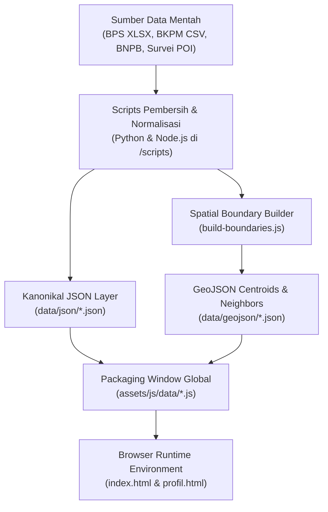
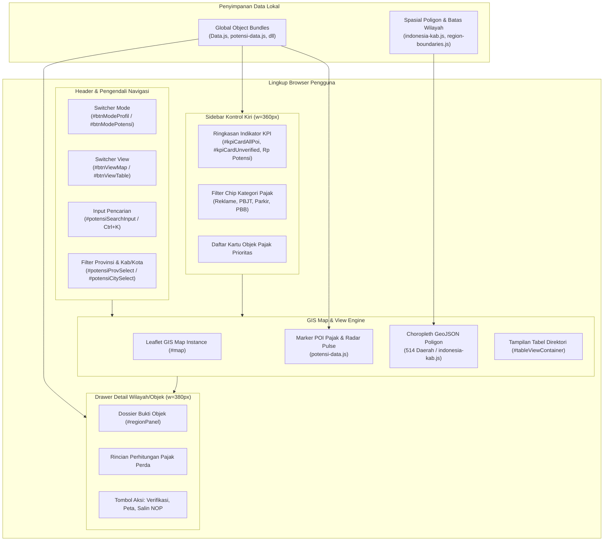

# Product Requirements Document (PRD) & Analisis Sistem End-to-End
## Platform Web GIS Statistik Makro & Intelijen Potensi Pajak Daerah (PAD360)

---

## 1. Ringkasan Eksekutif & Visi Produk

### 1.1 Visi Produk
**Portal Data Indonesia & PAD360** adalah platform visualisasi data geospasial (Web GIS) terpadu dan sistem intelijen statistik daerah yang memadukan dua kapabilitas utama dalam satu arsitektur terintegrasi:
1. **Mode Profil Statistik Makro (514 Kabupaten & Kota di 38 Provinsi)**: Portal diseminasi indikator pembangunan resmi BPS (IPM, PDRB, Demografi, Pertanian, Konsumsi, Sosial, dan PODES) dengan visualisasi tematik *Choropleth* dan dossier analitis 9 tab sektoral.
2. **Mode Peta Potensi Pajak Daerah (PAD360)**: Perangkat intelijen spasial dan *field evidence verification* bagi Badan Pendapatan Daerah (Bapenda) untuk mengidentifikasi *revenue leakage*, memetakan titik objek pajak (POI PBJT, Reklame, Parkir, PBB-P2), menghitung estimasi potensi penerimaan berbasis tarif Perda, dan memantau status jatuh tempo ketetapan pajak.

### 1.2 Konteks Proyek & Batasan Operasional
* **Status Proyek**: Prototipe/Mockup Interaktif tingkat lanjut untuk demonstrasi pimpinan, evaluasi magang/PKL di lingkungan instansi, dan uji rancang sistem informasi sebelum dihubungkan ke database relasional Bapenda skala penuh.
* **Lingkungan Eksekusi**: *Zero-Build Offline-First Stack* (Vanilla HTML5, CSS3, ES6 JavaScript) yang dapat dijalankan secara instan di browser lokal melalui web server lokal (Laragon/XAMPP/Live Server) maupun via protokol file langsung (`file:///`) tanpa memerlukan dependensi Node.js compiler.

---

## 2. Analisis Kelemahan Sistem & Utang Teknis (Critical Evidence-Aware Audit)

Berdasarkan audit menyeluruh terhadap struktur kode sumber, aliran data, dan aset, ditemukan sejumlah kelemahan arsitektural yang wajib ditangani dalam siklus pengembangan:

### 2.1 [High confidence] *Synchronous Mega-Bundle Overhead* pada Halaman Profil
* **Temuan**: File [`profil.html`](file:///c:/laragon/www/PKL/mockup/profil.html) memuat 16 file script data secara sinkronis pada saat DOM di-parsing:
  * `pertanian-data.js` (6,44 MB / 12,5 MB JSON equivalent)
  * `konsumsi-data.js` (5,61 MB / 11,1 MB JSON equivalent)
  * `industri-besar-sedang-data.js` (5,63 MB / 9,2 MB JSON equivalent)
  * `potensi-data.js` (5,22 MB)
  * `investasi-sektor-data.js` (2,76 MB)
  * `sosial-data.js` (1,58 MB)
  * `ekosistem-usaha-data.js` (1,33 MB)
  * `Data.js` (1,26 MB)
  * Serta data sektoral lainnya (`jalan`, `darurat`, `bandara`, `kemiskinan`, `pdrb-sektor`).
* **Dampak**: Total payload JavaScript yang dievaluasi di memori browser mencapai **~28,5 MB**. Pada perangkat berspesifikasi rendah, pemuatan awal menyebabkan lonjakan *DOM heap memory* hingga >220 MB dan memicu *long task thread block* selama 800–1.800 ms.

### 2.2 [High confidence] Polusi Global Namespace & Redundansi Ganda
* **Temuan**: Seluruh data didefinisikan ke variabel global window (`window.PotensiData`, `window.INDONESIA_KAB_GEOJSON`, `const REGION_DATA`, `const KONSUMSI_DATA`, dll.). Data tersimpan ganda di dua folder:
  * Folder `data/json/*.json` (format JSON murni kanonikal)
  * Folder `assets/js/data/*.js` (format bungkus JS `window.X = {...}`)
* **Penyebab**: Solusi darurat agar browser tidak memblokir pembacaan data akibat restriksi CORS saat file dibuka menggunakan protokol `file:///`.
* **Kelemahan**: Terjadi risiko desinkronisasi jika pengembang memperbarui file di `data/json/` tanpa menjalankan skrip kompilasi ulang ke `assets/js/data/`.

### 2.3 [High confidence] AI-Slop & Artefak Emoticon Murahan
* **Temuan**: Ditemukan lebih dari 110 baris kode pada [`profil.html`](file:///c:/laragon/www/PKL/mockup/profil.html), [`assets/js/core/Profil.js`](file:///c:/laragon/www/PKL/mockup/assets/js/core/Profil.js), dan [`assets/js/core/potensi.js`](file:///c:/laragon/www/PKL/mockup/assets/js/core/potensi.js) yang memuat emoji dan simbol non-korporat (seperti `★`, `❦`, `♥`, `📊`, `🌾`, `🥔`, `⚠️`, `🔴`).
* **Dampak**: Menurunkan impresi kredibilitas resmi saat diinspeksi oleh manajemen Bapenda dan tidak selaras dengan standar desain antarmuka korporat Ivosight / Sociomile (Parry UI).

### 2.4 [Medium confidence] Kopling Erat Antara DOM dan Logika GIS
* **Temuan**: File [`assets/js/core/Map.js`](file:///c:/laragon/www/PKL/mockup/assets/js/core/Map.js) dan [`assets/js/core/potensi.js`](file:///c:/laragon/www/PKL/mockup/assets/js/core/potensi.js) menggunakan selector ID yang tertanam keras (*hardcoded*) ke struktur HTML spesifik (`#map`, `#regionPanel`, `#rpContent`, `#sidebarToggleBtn`). Perubahan struktur tata letak (misalnya saat migrasi ke Tailwind CSS Parry UI) berisiko memutus keterikatan event handler jika ID tidak direplikasi dengan presisi 100%.

---

## 3. Inventarisasi Aset, Pustaka Vendor & Struktur Direktori

### 3.1 Pustaka Eksternal (Vendor Libraries via CDN)
1. **Leaflet.js v1.9.4** (`leaflet.min.js` & `leaflet.min.css`):
   - Engine GIS rendering layer GeoJSON vektor poligon, layer marker tile OpenStreetMap, dan marker clustering.
2. **Apache ECharts v5.5.0** (`echarts.min.js`):
   - Engine visualisasi grafik analitis canggih di `profil.html` (Diagram Scatter Kuadran Investasi, Treemap PDRB, Diagram Radar IPM, Bar chart 17 Sektor).
3. **Google Fonts Typography**:
   - `DM Sans` (Weights 400, 500, 600, 700): Tipografi korporat modern untuk teks judul, narasi, dan antarmuka.
   - `Roboto Mono` / `Space Mono` (Weights 400, 700): Tipografi tabular untuk nilai mata uang (Rupiah), nomor register objek pajak (NOP), persentase, dan koordinat bujur/lintang.
   - `Material Symbols Outlined`: Simbol antarmuka standar Google untuk aksi interaktif (peta, tabel, filter, sorting).

### 3.2 Dekomposisi Pohon Direktori Sistem

```text
c:\laragon\www\PKL\mockup/
├── index.html                    # Halaman Utama (Dual-Mode: Choropleth Profil & Peta Potensi PAD360)
├── index-v2.html                 # Implementasi Mockup UI Baru berbasis Parry UI Design System
├── profil.html                   # Dossier Analitis Detail Kabupaten/Kota (9 Tab Sektoral)
├── DESIGN.md                     # Panduan Desain Resmi Parry UI & Anti-Slop Guidelines
├── README.md                     # Panduan Menjalankan Sistem & Dokumentasi Ringkas
├── vercel.json                   # Konfigurasi Deployment Serverless Edge Cache
│
├── assets/
│   ├── css/
│   │   ├── styles.css            # Desain Sistem Eksisting (Off-White Soft Palette & Leaflet Styles)
│   │   └── parry-theme.css       # Token Desain Baru (Parry UI: Slate Neutral, Emerald Accent, Pastel Badges)
│   └── js/
│       ├── core/
│       │   ├── Map.js            # Controller Peta GIS Choropleth & Kamera Asimetris FlyToBounds (77 KB)
│       │   ├── Profil.js         # Controller 9 Tab Profil Wilayah & Render 15+ Widget ECharts (351 KB)
│       │   ├── potensi.js        # Controller Peta Potensi Pajak PAD360, POI, Radar & Drawer (133 KB)
│       │   └── parry-enhancer.js # Skrip Enhancer Standarisasi Parry UI (7,7 KB)
│       └── data/                 # Bundel Data Global Objek Window (Total ~28 MB)
│           ├── Data.js           # Profil Dasar 514 Daerah (Luas, Penduduk, Pemimpin, Batas) (1,26 MB)
│           ├── indonesia-kab.js  # GeoJSON Poligon 514 Kabupaten/Kota se-Indonesia (691 KB)
│           ├── region-boundaries.js # Data Centroid, Bounding Box & Hubungan Spasial Tetangga (401 KB)
│           ├── potensi-data.js   # Basis Data POI Potensi Pajak PAD360 38 Provinsi (5,22 MB)
│           ├── investasi-sektor-data.js # Data Realisasi Investasi PMA/PMDN BKPM (2,76 MB)
│           ├── industri-besar-sedang-data.js # Data Industri Pengolahan BPS (5,63 MB)
│           ├── konsumsi-data.js  # Rincian Konsumsi Pangan/Non-Pangan Rumah Tangga (5,61 MB)
│           ├── pertanian-data.js # Statistik Produksi & Luas Panen Komoditas (6,44 MB)
│           ├── sosial-data.js    # Fasilitas Sekolah, Guru, Medis, & Rumah Sakit (1,58 MB)
│           ├── pdrb-sektor-data.js # Nilai Tambah 17 Sektor Lapangan Usaha ADHB/ADHK (989 KB)
│           ├── ekosistem-usaha-data.js # Distribusi Usaha & Klasifikasi Baku Lapangan Usaha (1,33 MB)
│           ├── fase1-layanan-data.js # Indikator Layanan Dasar & IPM Komponen (420 KB)
│           ├── jalan-data.js     # Kondisi Panjang Jalan Kabupaten/Prov/Nasional (345 KB)
│           ├── darurat-data.js   # Titik Bencana & Fasilitas Evakuasi BNPB (300 KB)
│           ├── bandara-data.js   # Titik Akses Transportasi Udara (155 KB)
│           ├── pasar-kerja-data.js # Statistik Angkatan Kerja TPAK & TPT (145 KB)
│           └── kemiskinan-data.js# Garis Kemiskinan & Indeks P1/P2 (119 KB)
│
├── data/
│   ├── geojson/                  # File Vektor Spasial Mentah Kanonikal
│   │   ├── indonesia-kab.json    # Poligon batas wilayah 514 kabupaten/kota
│   │   └── region-boundaries.json# Geometri batas rujukan
│   ├── json/                     # File Dataset Statistik Murni Kanonikal (JSON murni)
│   └── kemiskinan_raw.csv        # Tabel tabulasi mentah indikator kemiskinan
│
├── data-mentah/                  # Berkas Sumber Eksternal (BPS, BKPM, BNPB, Kemenhub)
│   ├── bandara.csv               # Data mentah sebaran bandar udara
│   ├── keadaan-darurat.csv       # Data mentah kebencanaan
│   ├── bkpm/                     # Ekstrak laporan investasi
│   ├── csv/                      # Tabulasi tabel BPS
│   ├── json/                     # Dump API mentah
│   └── xlsx/                     # Lembar kerja resmi BPS Kabupaten Dalam Angka
│
├── scripts/                      # Pipeline Transformasi Data (ETL) & Generator Spasial
│   ├── build-boundaries.js       # Algoritma hitung centroid spasial & deteksi daerah bertetangga
│   ├── build_even_potensi_data.js# Generator sintesis sebaran POI pajak nasional
│   ├── build_investasi_sektor_data.py # Parser & normalisasi investasi BKPM
│   ├── build_jalan_data.py       # Parser statistik infrastruktur jalan daerah
│   ├── build_konsumsi_data.py    # Pipeline ekstraksi konsumsi rumah tangga
│   ├── build_pasar_kerja_data.py # Agregator data ketenagakerjaan
│   ├── build_pertanian_data.py   # Parser data komoditas pertanian 2023–2024
│   ├── build_sosial_data.py      # Parser fasilitas pendidikan & kesehatan
│   ├── convert_csv_to_json.js    # Konverter utilitas CSV ke JSON terstruktur
│   ├── enrich_potensi_data.py    # Pengaya metadata POI pajak (tax yield & rating)
│   └── import_bali_poi_data.py   # Ingestion data survei lapangan titik pajak Bali
│
├── stitch-previews/              # Folder Khusus Terisolasi Pratinjau Generasi Google Stitch
│   └── screen-1-dashboard-potensi.html # Pratinjau Screen 1 Dashboard Peta Potensi Parry UI
│
└── docs/                         # Repositori Dokumentasi Perencanaan Teknis Terstruktur
    └── 2026-11-11/
        ├── planning-revamp-ui-parry-design-system-lokal.md
        └── prd-portal-data-indonesia-pad360.md # Dokumen PRD ini
```

---

## 4. Analisis Skema Data & Pipeline ETL

### 4.1 Skema Data Utama

#### 4.1.1 Profil Induk Wilayah (`REGION_DATA` dalam `Data.js`)
Array berisi 514 objek representasi kabupaten/kota dengan struktur atribut:
```typescript
interface RegionRecord {
  no: number;                     // Nomor urut 1 - 514
  prov: string;                   // Nama Provinsi uppercase (contoh: "BALI")
  kabkota: string;                // Nama Kabupaten/Kota uppercase (contoh: "DENPASAR")
  kepala: string;                 // Nama Kepala Daerah (Bupati / Walikota)
  wakil: string;                  // Nama Wakil Kepala Daerah
  penduduk: number;               // Estimasi total penduduk (jiwa)
  keluarga: number;               // Jumlah kepala keluarga
  penduduk_per_keluarga: number;  // Rata-rata anggota per keluarga
  kepadatan: number;              // Kepadatan penduduk (jiwa/km²)
  luas: number;                   // Luas daratan resmi (km²)
  dataran: number;                // Jumlah desa berkarakteristik dataran
  lembah: number;                 // Jumlah desa berkarakteristik lembah
  lereng: number;                 // Jumlah desa berkarakteristik lereng
  puncak: number;                 // Jumlah desa berkarakteristik puncak
  total_desa: number;             // Total desa/kelurahan administratif
  kecamatan: number;              // Total kecamatan administratif
  batas_utara: string;            // Nama wilayah batas utara
  batas_selatan: string;          // Nama wilayah batas selatan
  batas_timur: string;            // Nama wilayah batas timur
  batas_barat: string;            // Nama wilayah batas barat
  elevasi: number | null;         // Ketinggian rata-rata di atas permukaan laut (mdpl)
  curah_hujan: number | null;     // Curah hujan tahunan (mm/tahun)
}
```

#### 4.1.2 GeoJSON Batas Spasial (`INDONESIA_KAB_GEOJSON`)
Standar format GeoJSON `FeatureCollection` yang merefleksikan 514 poligon administratif:
- Properti poligon memuat: `NAME_1` (Provinsi), `NAME_2` (Kabupaten/Kota), `TYPE_2` (Tipe: "Kabupaten" / "Kota"), `ENGTYPE_2` (Kode GADM), serta koordinat poligon/multipoligon berpresisi tinggi.
- Telah mengakomodasi pemekaran 4 Daerah Otonom Baru (DOB) Papua hasil undang-undang tahun 2022: *Papua Selatan, Papua Tengah, Papua Pegunungan, dan Papua Barat Daya*.

#### 4.1.3 Intelijen Potensi Pajak Daerah (`PotensiData` dalam `potensi-data.js`)
Struktur bertingkat dari level Provinsi ke level titik koordinat objek pajak (POI):
```typescript
interface PotensiDatabase {
  provinces: {
    id: string;                   // Slug unik (contoh: "bali")
    name: string;                 // Nama provinsi ("BALI")
    poi: number;                  // Akumulasi titik POI terpetakan
    ver: number;                  // Jumlah titik yang sudah diverifikasi
    pot: number;                  // Total potensi estimasi penerimaan (Miliar Rupiah)
    lat: number;                  // Titik koordinat pusat lintang
    lng: number;                  // Titik koordinat pusat bujur
    zoom: number;                 // Level zoom optimal kamera Leaflet
    data: "full" | "summary";     // Kelengkapan payload data
    kabkota?: {
      [kabkotaSlug: string]: {
        name: string;
        poiCount: number;
        verifiedCount: number;
        estimatedTotalRp: number;
        items: TaxPoiRecord[];
      }
    }
  }[];
}

interface TaxPoiRecord {
  id: string;                     // ID unik POI (contoh: "POI-DPS-001")
  name: string;                   // Nama objek/wajib pajak (contoh: "Bali Beach Hotel & Club")
  category: "reklame" | "parkir" | "pbjt_resto" | "pbjt_hotel" | "pbb_p2" | "air_tanah";
  address: string;                // Alamat detail lokasi
  lat: number;                    // Koordinat lintang
  lng: number;                    // Koordinat bujur
  nop: string;                    // Nomor Objek Pajak terdaftar (jika ada)
  status: "verified" | "urgent" | "unregistered" | "expiring";
  annualEstimatedRp: number;      // Estimasi potensi pajak tahunan (Rupiah)
  taxRatePercent: number;         // Tarif pajak daerah menurut Perda (contoh: 10%)
  basisCalculation: string;       // Dasar perhitungan (contoh: "Omzet x 10%" atau "Luas x NJOP")
  dueDateDays: number;            // Sisa hari jatuh tempo ketetapan
  evidenceImageUrl?: string;      // Bukti foto visual papan reklame/lokasi
}
```

### 4.2 Pipeline Transformasi & Ingestion Data (ETL)

Alur pemrosesan data dirancang dalam skrip otomatis:


---

## 5. Persona Pengguna & Alur Kerja (Workflows)

| Persona | Peran & Instansi | Kebutuhan Utama | Fitur Kunci yang Digunakan |
| :--- | :--- | :--- | :--- |
| **Bapak Hendra (52)** | Kepala Bapenda Kabupaten / Pimpinan Daerah | Memantau realisasi indikator makro, membandingkan IPM & PDRB antar daerah tetangga, dan memantau target proyeksi PAD. | Mode Profil Choropleth, Papan Peringkat Teratas/Terendah, Kuadran Investasi BKPM, & Ringkasan Potensi Pajak (Card KPI). |
| **Ibu Ratna (34)** | Analis Kebijakan Pajak Daerah (Bapenda) | Menemukan indikasi kebocoran pajak (*revenue leakage*), mengaudit objek pajak yang belum ber-NOP, dan menghitung potensi riil tahunan. | Mode Peta Potensi PAD360, Filter Kategori (Reklame, PBJT Resto, Parkir), Tabel Peringkat Pajak, & Detail Drawer Objek Pajak. |
| **Budi (28)** | Satgas Lapangan Verifikasi Pajak | Memeriksa bukti fisik di lapangan, memverifikasi kesesuaian ukuran reklame/kapasitas parkir terhadap pelaporan wajib pajak. | Titik Marker POI Spasial, Drawer Bukti Lapangan (*Evidence Dossier*), Navigasi GPS Objek Pajak, & Status Jatuh Tempo. |

---

## 6. Persyaratan Fungsional Sistem (Functional Requirements)

### 6.1 FR-01: Alih Mode Antarmuka Terintegrasi (*Dual-Mode Spatial Switcher*)
* **Deskripsi**: Sistem harus menyediakan mekanisme pergantian mode tampilan instan pada bar navigasi utama antara **Mode Profil Daerah** dan **Mode Peta Potensi**.
* **Kriteria Penerimaan (Acceptance Criteria)**:
  - Tombol `#btnModeProfil` dan `#btnModePotensi` aktif secara mutually exclusive.
  - Saat berpindah ke Mode Potensi: Layer poligon choropleth meredup (opacity turun ke 0.15), layer marker POI muncul dengan transisi halus, sidebar kiri bertransformasi ke kontrol filter potensi (`#sidebarPotensiView`), dan kartu KPI pajak diperbarui.
  - Saat berpindah ke Mode Profil: Layer POI disembunyikan, poligon choropleth aktif penuh sesuai metrik aktif, dan panel kontrol metrik makro ditampilkan.
  - State mode tidak boleh me-reload halaman browser (*zero page reload*).

### 6.2 FR-02: Peta Tematik Interaktif & Kamera Asimetris (*Asymmetrical FlyToBounds*)
* **Deskripsi**: Peta GIS harus memusatkan daerah target di tengah area pandang aktif tanpa tertutup oleh panel laci informasi kanan selebar 380px.
* **Kriteria Penerimaan**:
  - Pemanggilan fungsi `fitBounds` atau `flyToBounds` mengkalkulasi *bounding box* poligon dengan kompensasi padding kanan sebesar `paddingTopLeft: [20, 20]`, `paddingBottomRight: [400, 20]`.
  - Poligon daerah yang dipilih diberi efek garis tepi aktif (*highlight stroke*) berwarna biru aksen korporat dengan ketebalan 3px.
  - Skala warna choropleth (*color ramp*) harus konsisten secara semantik:
    - Metrik Positif (IPM): Skala Hijau Emerald (*High*) ke Kuning Amber (*Low*).
    - Metrik Risiko (Kemiskinan): Skala Hijau Rendah (*Low Risk*) ke Merah Korporat (*High Risk*).
    - Metrik Kepadatan & Luas: Gradien Slate-Teal seimbang.

### 6.3 FR-03: Visualisasi POI Spasial & Radar Pulse Intelijen Pajak
* **Deskripsi**: Objek pajak pada Mode Potensi harus dirender sebagai titik koordinat interaktif dengan status kepatuhan visual.
* **Kriteria Penerimaan**:
  - Marker dikelompokkan menurut status dengan kode warna standar Parry UI:
    - *Hijau Emerald*: Terverifikasi & Patuh.
    - *Kuning Amber*: Mendekati Jatuh Tempo (< 30 hari).
    - *Merah Coral*: Belum Terdaftar / Menunggak.
  - Objek prioritas tinggi menampilkan cincin gelombang radar beranimasi (*radar-pulse-ring*) untuk menarik perhatian petugas verifikasi tanpa mengganggu keterbacaan teks.
  - Mendukung penyaringan instan berdasarkan kategori objek pajak: Semua, Reklame, Parkir PBJT, PBJT Restoran/Hotel, dan PBB-P2.

### 6.4 FR-04: Drawer Detail Objek Pajak Berbasis Bukti (*Evidence Dossier Drawer*)
* **Deskripsi**: Mengklik salah satu marker POI atau kartu daftar objek membuka panel geser kanan (`#regionPanel`) yang memuat data terperinci objek pajak.
* **Kriteria Penerimaan**:
  - Menampilkan foto bukti lapangan, NOP resmi, nama wajib pajak, alamat lengkap, dan koordinat GPS.
  - Menampilkan kalkulasi rincian perhitungan potensi pajak: Tarif Perda, Dasar Pengenaan Pajak (DPP), dan Nilai Estimasi Pajak Tahunan.
  - Menyediakan tombol aksi: *Verifikasi Lapangan*, *Salin NOP*, dan *Buka Rute Navigasi Google Maps*.
  - Panel dapat ditutup secara responsif via tombol tutup `[ × ]` atau penekanan tombol keyboard `Esc`.

### 6.5 FR-05: Mode Ganda Tampilan Peta vs Tabel (*View Switcher*)
* **Deskripsi**: Sistem harus menyediakan alih pandang antara tampilan peta interaktif (*Map View*) dan direktori tabel komprehensif (*Table View*).
* **Kriteria Penerimaan**:
  - Tombol `#btnViewMap` dan `#btnViewTable` mengontrol visibilitas kontainer `#map` dan `#tableViewContainer`.
  - Pada Mode Tabel: Seluruh 514 kabupaten/kota atau daftar POI ditampilkan dalam tabel tabular berperforma tinggi dengan fitur pencarian teks, pengurutan kolom (*ascending/descending*), dan pagination cepat.

### 6.6 FR-06: Dossier Analitis Wilayah 9 Tab Sektoral (`profil.html`)
* **Deskripsi**: Halaman profil wilayah mendalam menyajikan gambaran 360 derajat kondisi kabupaten/kota melalui 9 tab tematik yang terorganisasi.
* **Kriteria Penerimaan**:
  - **Tab 1 — Investasi**: Menampilkan Hero total investasi PMA/PMDN, Scatter plot Kuadran Investasi (Pertumbuhan vs Realisasi), Peringkat Investasi Sektoral, dan Penyerapan Tenaga Kerja.
  - **Tab 2 — Wilayah & Geografi**: Batas 4 penjuru, topografi desa (dataran, lembah, lereng, puncak), elevasi, curah hujan, infrastruktur jalan, dan bandara terdekat.
  - **Tab 3 — Pemerintahan**: Profil pimpinan daerah, jumlah kecamatan/desa, dan diagram distribusi kursi partai politik DPRD hasil Pemilu 2024.
  - **Tab 4 — Kependudukan**: Piramida struktur penduduk, rasio jenis kelamin, jumlah keluarga, TPAK, dan TPT.
  - **Tab 5 — Ekonomi & Industri**: PDRB ADHB & ADHK, laju pertumbuhan ekonomi, bar chart 17 sektor ekonomi, garis kemiskinan, indeks kedalaman (P1) & keparahan (P2), serta profil industri besar & sedang.
  - **Tab 6 — Konsumsi Rumah Tangga**: Pengeluaran per kapita (makanan vs non-makanan) dan rincian konsumsi komoditas utama.
  - **Tab 7 — Pertanian**: Data panen padi, jagung, hortikultura, perkebunan, dan peternakan.
  - **Tab 8 — Sosial & Layanan Dasar**: Indeks Pembangunan Manusia (IPM), Diagram Radar 4 Dimensi IPM, Lollipop Gap Pendidikan (HLS vs RLS), ketersediaan dokter & rumah sakit, serta log darurat kebencanaan.
  - **Tab 9 — Infrastruktur Desa (PODES)**: Akses listrik (PLN vs non-PLN), status sinyal telekomunikasi 4G/5G, dan sanitasi.

### 6.7 FR-07: Sistem Pencarian Global & Filter Cepat (`Ctrl + K`)
* **Deskripsi**: Pengguna dapat mencari daerah mana saja dari 514 kabupaten/kota secara instan.
* **Kriteria Penerimaan**:
  - Dialog pencarian dapat dipicu melalui shortcut keyboard `Ctrl + K` atau klik pada bar pencarian header.
  - Hasil pencarian menampilkan nama kabupaten/kota, provinsi, dan metrik ringkas.
  - Memilih hasil pencarian otomatis menerbangkan (*flyTo*) kamera peta ke lokasi tersebut dan membuka drawer detailnya.

---

## 7. Persyaratan Non-Fungsional (Non-Functional Requirements)

### 7.1 Kinerja & Efisiensi Memori (Performance Budget)
* **Waktu Rendering Awal (FCP)**: Kurang dari 1,2 detik pada koneksi internet standar atau eksekusi localhost.
* **FPS Animasi Transisi**: Transisi geser drawer kanan dan alih mode minimal mencapai 55–60 FPS.
* **Optimasi Pemuatan Data**: Skrip data sektoral pada `profil.html` harus dimodularisasi ke dalam pola *lazy-loading on tab demand* untuk memangkas pemuatan awal memori dari ~28 MB menjadi < 5 MB pada pemuatan perdana.

### 7.2 Standar Desain Sistem & Aksesibilitas (WCAG 2.1 AA)
* **Kepatuhan Palet Parry UI**:
  - Kontras teks judul `#0f172a` (Slate-900) terhadap latar belakang kartu `#ffffff` minimal bernilai **13:1** (melebihi standar minimum 4.5:1).
  - Teks sekunder `#64748b` (Slate-500) terhadap latar kartu minimal bernilai **4.6:1**.
* **Anti-Slop Total**: Antarmuka 100% bebas dari emotikon dekoratif informal (`★`, `❦`, `♥`, dll.). Semua indikator status wajib menggunakan badge teks pastel resmi dengan border outline halus (contoh: `bg-emerald-50 text-emerald-700 ring-1 ring-emerald-600/20`).

### 7.3 Kompatibilitas Lingkungan (*Zero-Build Offline Resilience*)
* Sistem harus dapat berjalan tanpa error pada browser modern (Google Chrome, Microsoft Edge, Mozilla Firefox, Safari) versi 110 ke atas.
* Berkas harus dapat dieksekusi secara mandiri baik di bawah Apache/Nginx web server lokal (Laragon `localhost`) maupun via preview langsung tanpa server.

---

## 8. Arsitektur Komponen & Aliran Data Sistem



---

## 9. Matriks Mitigasi Risiko

| ID Risiko | Deskripsi Risiko | Tingkat Dampak | Probabilitas | Strategi Mitigasi Terencana |
| :---: | :--- | :---: | :---: | :--- |
| **R-01** | *Memory Leak* atau browser *freeze* akibat evaluasi serentak 28 MB JavaScript di `profil.html`. | **Tinggi** | Sedang | Pisahkan payload data berdasarkan tab aktif; hanya muat data pertanian dan konsumsi saat tab tersebut diklik oleh pengguna. |
| **R-02** | Ketidakcocokan nama kabupaten/kota antara GeoJSON dan data statistik BPS (*mismatch string*). | **Sedang** | Tinggi | Gunakan fungsi normalisasi string `cleanAlnum()` dan kamus alias `REGION_NAME_ALIASES` yang sudah teruji di `Profil.js`. |
| **R-03** | Inkonsistensi UI akibat penerapan parsial antara file CSS lama (`styles.css`) dan tema baru (`parry-theme.css`). | **Tinggi** | Sedang | Terapkan aturan isolasi sandbox: pertahankan `index.html` dan `assets/css/styles.css` dalam keadaan utuh, lakukan seluruh inovasi pada `index-v2.html` dan `assets/css/parry-theme.css`. |
| **R-04** | Kehilangan fitur fungsional saat regenerasi antarmuka melalui Google Stitch. | **Tinggi** | Rendah | Menggunakan metode **Cara 2**: Injeksi rangka semantik DOM HTML asli ke dalam prompt Stitch sehingga seluruh ID elemen dan tombol fungsional terkunci. |

---

## 10. Rencana Implementasi & Roadmap Modernisasi

### Fase 1: Standardisasi Desain Parry UI & Pembersihan Anti-Slop (Tahap Berjalan)
- [x] Konfigurasi dan perbaikan MCP Server Google Stitch (`stitch-pro-mcp`).
- [x] Isolasi ruang pratinjau hasil generasi Stitch pada folder [`stitch-previews/`](file:///c:/laragon/www/PKL/mockup/stitch-previews).
- [x] Generasi rancangan visual Screen 1 (Dashboard Peta Potensi) di Stitch mengacu pada DOM skeleton asli `index.html`.
- [ ] Tinjauan pengguna terhadap Screen 1.
- [ ] Generasi rancangan visual Screen 2 (Dossier Profil 9 Tab BPS) di Stitch tanpa artefak emoji.
- [ ] Generasi rancangan visual Screen 3 (Direktori Tabel Analitik PAD360) di Stitch.

### Fase 2: Implementasi Terisolasi ke Codebase Lokal (Setelah Persetujuan Pengguna)
- [ ] Menerapkan rancangan visual yang telah disetujui pengguna ke dalam [`index-v2.html`](file:///c:/laragon/www/PKL/mockup/index-v2.html) dan [`assets/css/parry-theme.css`](file:///c:/laragon/www/PKL/mockup/assets/css/parry-theme.css).
- [ ] Membersihkan 110+ baris simbol/emotikon AI-slop pada [`profil.html`](file:///c:/laragon/www/PKL/mockup/profil.html), [`assets/js/core/Profil.js`](file:///c:/laragon/www/PKL/mockup/assets/js/core/Profil.js), dan [`assets/js/core/potensi.js`](file:///c:/laragon/www/PKL/mockup/assets/js/core/potensi.js).
- [ ] Verifikasi komparatif browser lokal: Memastikan seluruh fitur Leaflet dan event handler interaktif tetap 100% berfungsi normal.

### Fase 3: Optimasi Arsitektur Data & Kinerja (Tahap Lanjutan)
- [ ] Mengubah pemuatan skrip data statis di `profil.html` menjadi asynchronous on-demand (`fetch` atau dynamic `import()`).
- [ ] Sinkronisasi otomatis dua arah antara `data/json/*.json` dan `assets/js/data/*.js`.
- [ ] Integrasi IndexedDB lokal browser untuk *caching* poligon GeoJSON 514 kabupaten sehingga tidak perlu di-parse berulang kali.

---
*Dokumen ini disusun secara otomatis berdasarkan analisis menyeluruh terhadap seluruh struktur kode sumber, aliran data, dan aset repositori pada 11 November 2026.*

