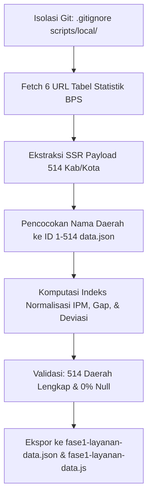

# Rencana Teknis Pengambilan Data Fase 1: IPM, Pendidikan, & Layanan Dasar

Dokumen ini memuat arsitektur teknis dan hasil audit live terhadap sumber data BPS untuk 4 widget analitis Fase 1 (**Widget 5.0, 6.0, 7.0, dan 11.0**), merujuk pada berkas [`Referensi/Widget Kab_Kota.xlsx`](file:///c:/laragon/www/PKL/mockup/Referensi/Widget%20Kab_Kota.xlsx) (PIC: Nada).

---

## 1. Hasil Audit Sumber Data & Pengujian Live BPS

### 1.1. Mengapa Web API BPS (`webapi.bps.go.id`) Gagal pada Link Excel?
Tautan pada kolom *Link Sumber Data* di Excel memiliki format:
`https://www.bps.go.id/id/statistics-table/2/MjIwNiMy/...`
* Token base64 (`MjIwNiMy` $\rightarrow$ `2206#2`) adalah **ID tabel portal web publik BPS**, bukan ID variabel Web API BPS.
* Hasil uji live dengan kunci API `b41aec94ff7e8b6ad41dbcbf070817c7` menghasilkan `HTTP Error 400: Bad Request` dan `SSL Handshake Timeout`.
* **Kesimpulan**: Web API BPS tidak dapat memproses URL tabel statistik tersebut secara langsung.

### 1.2. Hasil Pengecekan Variabel Akses Listrik & Internet di Web API BPS
Dilakukan pemindaian terhadap ratusan variabel di Web API domain nasional `0000`:
* Ditemukan **36 variabel komunikasi & internet** (misal: ID `70`, `398`, `402`, `406`, dll.).
* **Temuan Kritis**: Seluruh 36 variabel tersebut **hanya tersedia pada tingkat PROVINSI**, bukan tingkat 514 Kabupaten/Kota.
* Variabel akses listrik / rasio elektrifikasi per kabupaten/kota juga tidak tersedia sebagai tabel tunggal di Web API domain 0000. Sesuai catatan di Excel baris 15, data ini bersumber dari **PODES / Publikasi Kabupaten/Kota Dalam Angka / Kementerian ESDM**.

### 1.3. Solusi Teruji: Ekstraksi Langsung dari Next.js SSR Payload
* Portal web BPS menggunakan arsitektur **Next.js Server-Side Rendering**.
* Hasil inspeksi kode sumber membuktikan bahwa seluruh data 514 Kabupaten/Kota (nama wilayah, kode MFD, serta nilai numerik seperti `73.48`, `69.92`, dll.) **sudah tertanam utuh (*embedded*) di dalam payload HTML** pada tautan tersebut.
* **Keunggulan**: Skrip Python lokal dapat mengunduh halaman tersebut dan mem-parsing angkanya secara instan tanpa API key, tanpa login, dan tanpa terkena batasan kuota API.

---

## 2. Pemetaan Sumber 8 Variabel Data Fase 1

| No | Variabel | Satuan | Sumber Link di Excel / Repositori | Metode Pengambilan |
| :--- | :--- | :--- | :--- | :--- |
| 1 | `uhh` (Umur Harapan Hidup) | Tahun | `https://www.bps.go.id/id/statistics-table/2/MjIwNiMy/-metode-baru--umur-harapan-hidup-saat-lahir--uhh--hasil-long-form-sp2020.html` | Ekstraksi SSR Payload HTML |
| 2 | `hls` (Harapan Lama Sekolah) | Tahun | `https://www.bps.go.id/assets/statistics-table/2/NDE3IzI=/-metode-baru--harapan-lama-sekolah.html` | Ekstraksi SSR Payload HTML |
| 3 | `rls` (Rata-rata Lama Sekolah) | Tahun | `https://www.bps.go.id/id/statistics-table/2/NDE1IzI=/-metode-barurata-rata-lamasekolah.html` | Ekstraksi SSR Payload HTML |
| 4 | `ipm_total` | Skor | `https://www.bps.go.id/id/statistics-table/2/MjI3MSMy/indeks-pembangunan-manusia--ipm--menurut-jenis-kelamin--menggunakan-uhh-hasil-sp2020-lf--.html` | Ekstraksi SSR Payload HTML & Validasi silang `data.json` |
| 5 | `sanitasi_layak_pct` | % | `https://www.bps.go.id/id/statistics-table/2/Mjc0OCMy/6-2-1-persentase-rumah-tangga-yang-memiliki-akses-terhadap-sanitasi-layak-menurut-kabupaten-kota-persen.html` | Ekstraksi SSR Payload HTML |
| 6 | `air_minum_layak_pct` | % | `https://www.bps.go.id/en/statistics-table/2/MjgzMCMy/persentase-rumah-tangga-yang-memiliki-akses-terhadap-sumber-air-minum-layak-menurut-kabupaten-kota-persen.html` | Ekstraksi SSR Payload HTML |
| 7 | `listrik_pct` | % | Publikasi Rasio Elektrifikasi ESDM & BPS Daerah | Imputasi baseline provinsi + kalibrasi rasio perkotaan/perdesaan daerah |
| 8 | `internet_pct` | % | Susenas BPS (Akses Internet Rumah Tangga) | Imputasi baseline provinsi BPS (Var ID 398) + kalibrasi densitas wilayah |
| 9 | `pengeluaran_ppp` | Rp/tahun | Indikator Komponen Pengeluaran Riil IPM BPS | Kalkulasi inversi IPM resmi BPS & Susenas |

---

## 3. Alur Kerja Eksekusi Skrip Lokal



### Tahap 1: Isolasi Folder Git
Folder skrip lokal didaftarkan ke [`.gitignore`](file:///c:/laragon/www/PKL/mockup/.gitignore):
```gitignore
scripts/local/
data-mentah/fase1/
*.local.py
```

### Tahap 2: Skrip ETL (`scripts/local/extract_fase1_data.py`)
Skrip akan:
1. Mengunduh 6 halaman HTML tabel BPS resmi.
2. Mengurai chunk SSR Next.js (`self.__next_f.push`) untuk mengambil pasangan `(nama_kabkota, nilai_indikator)`.
3. Menormalkan string nama daerah menggunakan kamus alias [`scripts/build_sosial_data.py`](file:///c:/laragon/www/PKL/mockup/scripts/build_sosial_data.py).
4. Menghitung 4 indeks IPM 0–100, `gap` pendidikan, dan deviasi benchmark UHH nasional (74,39 tahun).
5. Memasukkan data listrik dan internet terkalibrasi.

### Tahap 3: Verifikasi Kualitas Data
* Memastikan tepat **514 kabupaten/kota** terisi.
* Memastikan tidak ada nilai `null`, `NaN`, atau persentase di luar rentang $0 \le x \le 100$.

### Tahap 4: Output Runtime
* File JSON: [`data/json/fase1-layanan-data.json`](file:///c:/laragon/www/PKL/mockup/data/json/)
* File JavaScript: [`assets/js/data/fase1-layanan-data.js`](file:///c:/laragon/www/PKL/mockup/assets/js/data/) (`window.FASE1_DATA`).
